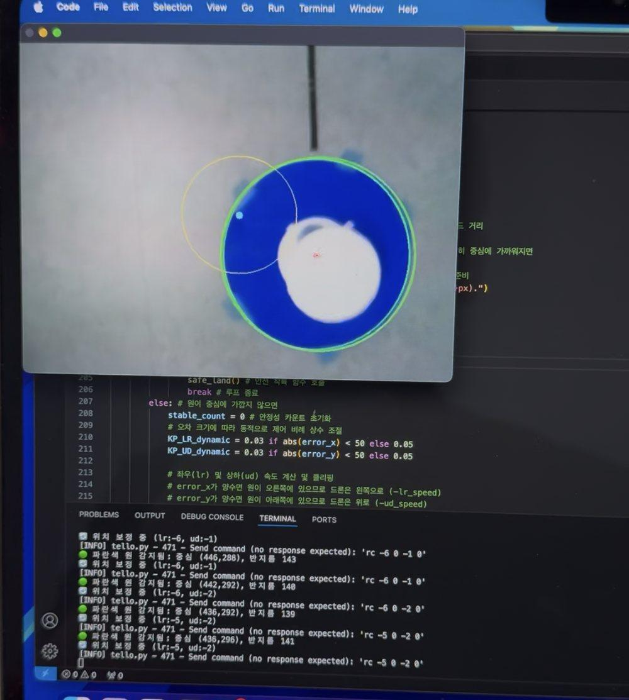

# 🛸 자율비행 드론: 영상처리 기반 마커 착륙

> **제8회 전국대학교 인공지능 드론경진대회 은상** 🥈
> 대한전자공학회 산업전자소사이어티 · 2025.06.20

DJI Tello 드론이 **지정된 경로를 자율비행한 뒤, 바닥의 색상 마커(빨강/파랑 원)를 카메라로 찾아 그 위에 정렬해 착륙**하는 프로그램입니다.

▶️ **시연 영상:** [YouTube Shorts](https://youtube.com/shorts/TDFCDi0GSOg)

<p align="center">
  
</p>

> 파란 마커가 검출되면 초록 테두리로 표시되고, 화면 중심의 노란 원이 착륙 허용 오차 범위입니다.
> 아래 터미널에는 `원 감지 → 위치 보정 (lr:-6, ud:-1) → rc -6 0 -1 0` 명령까지 검출부터 기체 제어로 이어지는 루프가 찍혀 있습니다.

<br>

## 📌 개요

| 항목 | 내용 |
|---|---|
| 기간 | 2025.06 |
| 인원 | 3인 팀 |
| 담당 | **영상처리 기반 자율착륙** (마커 검출 · 위치 보정 제어 · 착륙 로직) |
| 기체 | DJI Tello (영상은 PC에서 처리) |
| 결과 | 제8회 전국대학교 인공지능 드론경진대회 **은상** |

## 🛠 기술 스택

| 분류 | 사용 기술 |
|---|---|
| 언어 · 라이브러리 | Python, OpenCV, djitellopy, NumPy |
| 검출 | HSV 색상 마스킹, 허프 원 변환, 겹침 면적 검증 |
| 제어 | 비례 제어(P), 동적 게인 조정, 5프레임 안정성 확인 |

## 🔄 동작 흐름

```
이륙
 └─ 사전 정의된 경로 비행 (상승 → 전진 → 회전 → ...)
     └─ 마커 탐색 (빨강 우선, 없으면 파랑)
         ├─ 못 찾음 → 정지 후 재탐색 → 계속 못 찾으면 10°씩 회전하며 탐색
         └─ 찾음 → 화면 중심과의 오차만큼 좌우·상하 보정
             └─ 5프레임 연속 허용 오차 안 → 앞으로 이동 후 착륙
```

## 💡 풀어야 했던 문제

### 1. 가짜 원이 잡히는 문제
HSV 색상 마스크에 허프 원 변환만 적용하면 조명과 그림자 때문에 실제 마커가 아닌 원이 검출됐습니다.
→ 검출된 원과 색상 마스크의 **겹침 면적이 원 면적의 50%를 넘을 때만** 유효한 마커로 인정하는 검증 단계를 추가해 오검출을 걸러냈습니다.

### 2. 마커 위에 정확히 내려앉기
화면 중심과 마커 중심의 픽셀 오차를 좌우·상하 속도로 변환하는 **비례 제어**를 넣었습니다.
- 오차가 50px 이내로 들어오면 **게인을 낮춰** 과도한 진동을 억제
- 한 프레임만 보고 판단하면 오판할 수 있어, **5프레임 연속**으로 허용 오차 안에 머물 때만 착륙 단계로 진입

### 3. 실패해도 기체를 지키기
- 마커를 놓치면 제자리 정지 후 재탐색, 계속 못 찾으면 **10°씩 회전**하며 탐색 범위 확장
- **배터리 20% 미만**이거나 미검출이 지속되면 강제 착륙
- 비행 경로는 **별도 스레드**에서 실행하고, 메인 스레드는 영상 출력과 `q` 키 입력을 받아 언제든 사람이 개입 가능
- 종료 시 `finally`에서 스트림과 연결을 반드시 해제

## ▶️ 실행 방법

```bash
pip install -r requirements.txt
# PC를 Tello 드론 Wi-Fi에 연결한 뒤
python main.py
```

- 비행 중 `q` 키: 즉시 비행 중단 및 착륙
- ⚠️ 비행 경로(`fly_route`의 이동 거리·회전 각도)는 대회 코스에 맞춘 값입니다. 다른 환경에서는 조정이 필요합니다.
